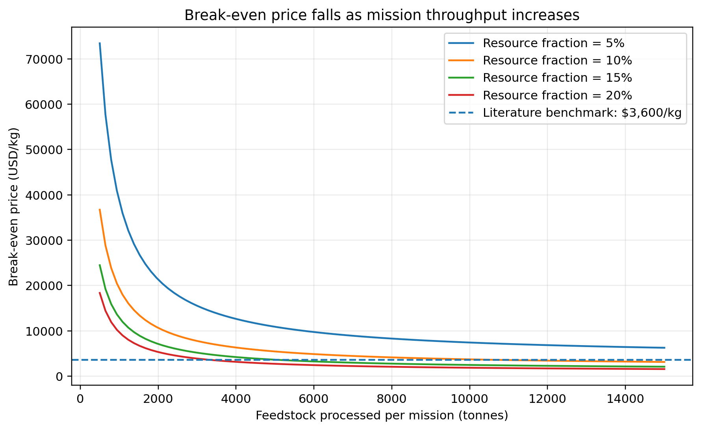
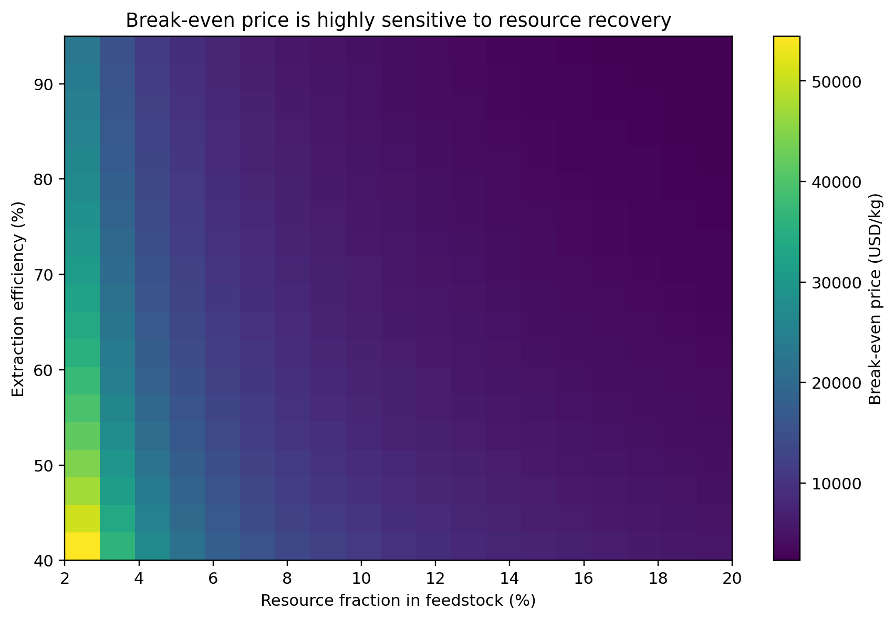
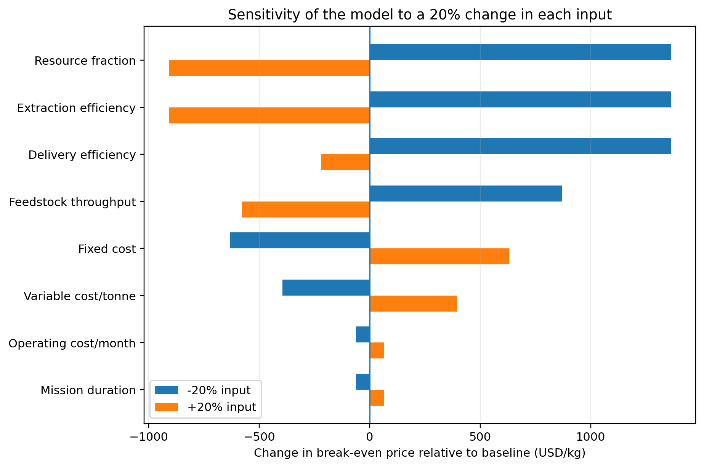
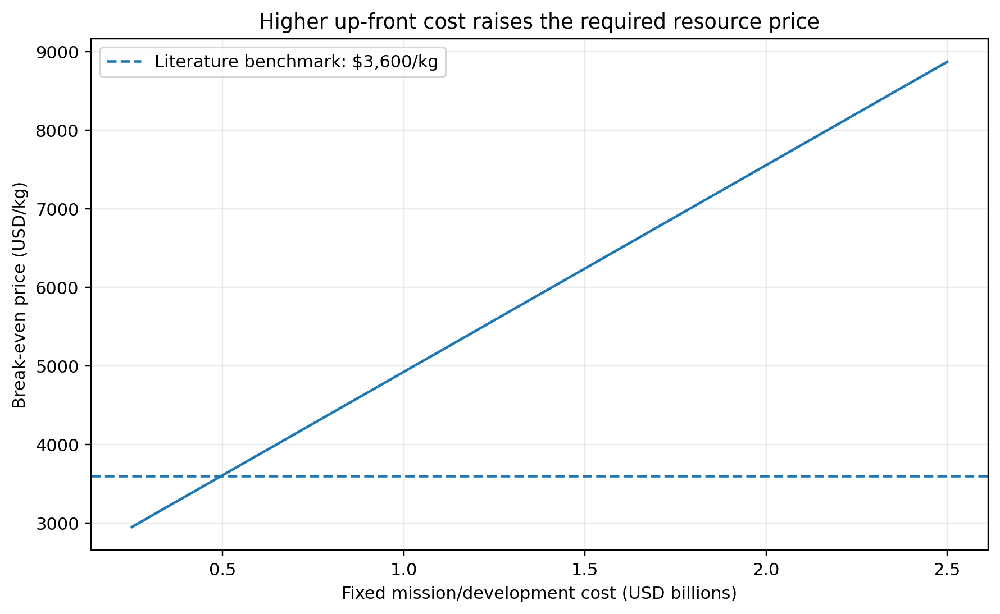

# The Technological and Economic Constraints of Asteroid Mining

*Independent Research Project*

**Author:** Panshul Bhambhani

**Date:** 5 October 2026

**Research question:** In a simplified asteroid-mining scenario, how do selected technical and economic assumptions affect the required break-even resource price, and what does this imply about potential commercial viability?

**Project type:** Independent literature review and computational scenario analysis

## Abstract

Asteroid mining is often described as a future source of water, metals, and other materials, but the presence of useful resources does not by itself make a mining mission commercially viable. A complete system must locate and characterize a suitable asteroid, reach it, operate in very low gravity, extract and process the resources, transport the resulting product, and sell it to a customer. This project combines a review of NASA and peer-reviewed literature with a Python scenario model to examine how selected technical and economic variables influence the break-even price for a hypothetical asteroid-resource mission. The model calculates delivered resource mass from feedstock throughput, resource fraction, extraction efficiency, and delivery efficiency, then compares that output with fixed, variable, and operating costs. Under the baseline scenario, 5,000 tonnes of asteroid feedstock are processed, 10% of the feedstock is assumed to be the target resource, and extraction and delivery efficiencies are 80% and 95%, respectively. A notional total mission cost of $2.07 billion yields 380 tonnes of delivered resource and a break-even price of approximately $5,447 per kilogram. This result is compared with a 2020 study that estimated a cost of at least approximately $3,600/kg for delivering asteroid-derived propellant to lunar orbit. This is a contextual comparison only: the products, system boundaries, and assumptions differ, so the figures are not directly equivalent or market prices. Sensitivity analysis shows that resource fraction, extraction efficiency, and throughput strongly affect the required break-even price, while higher fixed and variable costs increase it. The model is not a commercial forecast; it demonstrates a reproducible method for exploring which assumptions matter most. Overall, the literature and model suggest that asteroid mining is a systems-engineering problem involving mission architecture, throughput, resource accessibility, infrastructure costs, and the eventual market for space-based resources.

**Keywords:** asteroid mining; in-situ resource utilization; techno-economic analysis; sensitivity analysis; Python

## 1. Introduction

Asteroids are remnants of the early Solar System and may contain water-bearing minerals, carbon-rich compounds, metals, and other materials. Researchers have investigated their potential as resource sources because obtaining materials in space could reduce the amount that must be launched from Earth for future exploration and industry. NASA describes in-situ resource utilization (ISRU) as using local resources at mission destinations to create useful products, including water, oxygen, propellant, and construction materials. NASA’s ISRU work includes technologies for excavating or drilling resource-bearing material and processing, transporting, and storing the resulting products [1].

Evidence that some asteroids contain potentially useful materials is no longer purely theoretical. NASA's OSIRIS-REx mission returned 121.6 grams of material from near-Earth asteroid Bennu [9]. Analyses of the sample found carbon-rich material and minerals associated with water, while later work identified phosphate-bearing material and evidence of aqueous alteration [2, 3]. These findings show that primitive asteroids can preserve chemically and mineralogically interesting materials. They do not, however, demonstrate that these materials can be mined economically at industrial scale.

The central challenge is to connect resource availability to a complete mission architecture. A mining venture would need a suitable target, a cost-effective trajectory, reliable mining equipment, an extraction and processing system, power and communications, storage, and a customer willing to purchase the resulting resource. NASA notes that important knowledge gaps remain concerning the location, form, concentration, and distribution of extraterrestrial resources, as well as how they should best be extracted and processed [1].

Economic research reaches a similar conclusion. Hein, Matheson, and Fries developed a techno-economic model of asteroid mining and identified throughput, the number of spacecraft, and the rate at which missions can be repeated as important drivers of economic performance [4]. Colvin, Crane, and Lal examined asteroid-derived water for propellant and found that the economics depend on mining and processing infrastructure costs, demand for resources in space, and the cost of launching equivalent resources from Earth [5]. A 2026 model by Dorrington and Olsen further formalizes profit, net present value, mass payback, and a break-even mass ratio for several asteroid-mining architectures, emphasizing the importance of propulsion performance and mission architecture [6].

This project asks: **In a simplified asteroid-mining scenario, how do selected technical and economic assumptions affect the required break-even resource price, and what does this imply about potential commercial viability?**

Rather than attempting to predict the future asteroid-mining industry, the project uses a transparent scenario model to test the direction and relative importance of several variables. The analysis focuses on resource throughput, resource fraction, extraction efficiency, delivery efficiency, fixed development cost, variable processing cost, and operating cost.

## 2. Background and Literature Review

### 2.1 Resource availability

An asteroid's value depends not only on the amount of a resource it contains, but also on the resource's chemical form and accessibility. NASA's ISRU research emphasizes that future resource systems must determine where resources are located, their form and concentration, and how they can be extracted and processed [1]. This is especially relevant to water because it may be chemically bound in hydrated minerals rather than present as easily accessible ice.

Bennu provides a useful scientific example. NASA reports that the returned sample contains carbon-rich material and minerals associated with water and aqueous alteration [2, 3]. These findings show why resource characterization matters: remote observations do not necessarily reveal every feature that might be found in a returned sample, and evidence that a material exists does not establish that it is economically recoverable.

### 2.2 The low-gravity mining problem

Mining on Earth benefits from gravity and the mass of heavy equipment. On a small asteroid, gravity may be too weak for a conventional excavator to generate enough reaction force to penetrate the surface. NASA's Regolith Advanced Surface Systems Operations Robot (RASSOR) uses counter-rotating excavation drums to reduce net reaction forces in low-gravity environments [7]. RASSOR is a lunar excavation concept, not a demonstrated asteroid-mining system, but it illustrates one approach to this engineering problem.

More broadly, asteroid mining requires equipment designed for an environment very different from terrestrial mines. Systems may need to anchor themselves, manage loose regolith, tolerate vacuum and thermal cycling, and operate with limited human intervention.

### 2.3 Processing and ISRU

Mining materials is only the beginning. The desired resource must be separated from the surrounding material, purified, and stored. For water-based resource utilization, additional processing may be required to turn extracted water into usable propellants or other products.

NASA’s ISRU technology work includes excavation, processing, transportation, and storage technologies, while many relevant demonstrations have been conducted in simulated or analog environments rather than during long-duration operations in space [1]. A process that works in an Earth laboratory or a short analog test still needs to demonstrate reliable operation in the actual space environment.

### 2.4 Transportation and trajectory accessibility

NASA's Near-Earth Object Human Space Flight Accessible Targets Study (NHATS) provides trajectory information for near-Earth asteroids, including estimated delta-v and duration for candidate trajectories [8]. These parameters matter because propulsion requirements influence spacecraft mass, mission duration, and cost. NHATS was developed to study accessibility for human-spaceflight missions, so it should not be treated as a validated list of commercial mining targets.

Dorrington and Olsen's 2026 study incorporates propulsion and trajectory parameters into asteroid-mining economics. Under their specific assumptions, they found that single-trip missions relying entirely on propellant supplied from Earth become constrained at higher target delta-v values, while multi-trip architectures and the use of asteroid-derived return propellant can improve the economic picture [6]. These findings apply to the architectures and assumptions in their model; they are not universal thresholds for every possible mission.

### 2.5 The market for resources in space

The economic case depends strongly on where a resource will be used. Colvin, Crane, and Lal found that asteroid-derived propellant may be more attractive for some destinations beyond low Earth orbit than for Earth orbit because Earth-launched resources face different transportation costs [5]. In their scenarios, they estimated demand of roughly 5,750 to 9,876 tonnes of LOX/LH2 propellant over 2031–2050 and an asteroid-derived delivery cost of at least about $3,600/kg for lunar orbit [5].

This figure is used only as a contextual literature benchmark. It is not treated as a market price or a guaranteed willingness-to-pay value, and it is not directly equivalent to the break-even price calculated by the scenario model in this project.

## 3. Research Question and Hypothesis

### Research question

**In a simplified asteroid-mining scenario, how do selected technical and economic assumptions affect the required break-even resource price, and what does this imply about potential commercial viability?**

### Hypothesis

The hypothesis is that higher feedstock throughput, higher resource fraction, and higher extraction and delivery efficiencies will reduce the break-even resource price, while higher fixed, variable, and operating costs will increase it. Because fixed development costs are spread over the amount of resource delivered, higher throughput is expected to lower the break-even price, particularly at lower production volumes.

## 4. Methodology

### 4.1 Model design

A simplified deterministic scenario model was implemented in Python. It does not attempt to reproduce a complete trajectory optimizer, spacecraft design, or financial-market forecast. Instead, it isolates a small set of variables that the literature identifies as economically important and examines how they affect the break-even resource price.

The model first calculates the amount of resource successfully delivered to a customer:

**M_delivered = M_feedstock x f_resource x eta_extraction x eta_delivery**

where:

- M_feedstock is the mass of asteroid feedstock processed.

- f_resource is the fraction of the feedstock that is the target resource.

- eta_extraction is the fraction of the contained resource recovered by the mining and processing system.

- eta_delivery is the fraction that survives transport and reaches the customer as a usable product.

The total modeled cost is:

**C_total = C_fixed + C_variable + C_operations**

with:

**C_variable = M_feedstock x c_variable**

and:

**C_operations = T x c_operations**

Here, C_fixed is the fixed mission/development cost; c_variable is the variable mining and processing cost per tonne of feedstock; T is mission duration in months; and c_operations is the monthly operating cost.

Finally, the required break-even resource price is:

**P_break-even = C_total / M_delivered**

This quantity answers a practical question: given the assumptions, how much revenue would have to be obtained per kilogram of delivered resource to recover the modeled cost?

### 4.2 Baseline assumptions

The baseline scenario is a notional modeling scenario, not an estimate of the cost of a real planned mission. The assumptions are deliberately simplified so that the model is easy to understand, modify, and reproduce.

| Parameter | Baseline value | Type |

| --- | --- | --- |

| Feedstock processed | 5,000 tonnes | Modeling assumption |

| Resource fraction | 10% | Modeling assumption |

| Extraction efficiency | 80% | Modeling assumption |

| Delivery efficiency | 95% | Modeling assumption |

| Fixed mission/development cost | $1.20 billion | Modeling assumption |

| Variable processing cost | $150,000/tonne feedstock | Modeling assumption |

| Mission duration | 24 months | Modeling assumption |

| Operating cost | $5 million/month | Modeling assumption |

| Contextual literature benchmark | $3,600/kg | Colvin, Crane & Lal (2020) [5] |

The baseline assumptions are intentionally simple so that the model can be understood, modified, and reproduced. They are not current commercial quotations or empirically established costs for a specific asteroid-mining mission.

### 4.3 Sensitivity analysis

The project evaluates sensitivity in three ways.

First, feedstock throughput is varied while the other baseline inputs are held constant. This tests whether spreading fixed costs over a larger production volume changes the required break-even price.

Second, resource fraction and extraction efficiency are varied together to produce a two-dimensional sensitivity surface.

Third, each major input is changed nominally by plus or minus 20% from the baseline while the other variables are held constant. For percentage-valued inputs, an increased value is capped at 99% if needed to remain within the model’s specified range; consequently, the increase for a parameter already near the upper bound may be smaller than 20%. The resulting change in break-even price is used to identify which assumptions have the largest local effect.

### 4.4 Reproducibility

All calculations were implemented in Python using NumPy and Matplotlib. The repository contains the model code, baseline assumptions, output tables, and generated figures. The scripts can regenerate the figures from the model inputs, allowing assumptions to be tested without manually rebuilding the analysis.

## 5. Results

### 5.1 Baseline calculation

The baseline model processes 5,000 tonnes of feedstock. With a resource fraction of 10%, the feedstock contains a modeled 500 tonnes of target resource. An extraction efficiency of 80% reduces this to 400 tonnes recovered, and a delivery efficiency of 95% produces 380 tonnes, or 380,000 kg, of delivered resource.

The fixed cost is $1.20 billion. Variable processing cost is $750 million, calculated as 5,000 tonnes multiplied by $150,000 per tonne. Operating cost is $120 million, calculated from 24 months at $5 million per month. The total modeled cost is therefore $2.07 billion.

The resulting break-even resource price is approximately:

**$2.07 billion / 380,000 kg = $5,447/kg**

The calculated value exceeds the $3,600/kg lunar-orbit benchmark reported by Colvin, Crane, and Lal [5]. However, this is not a like-for-like comparison: the study’s estimate concerns the delivery of asteroid-derived propellant to lunar orbit, whereas this model calculates a break-even price under a simplified and generic resource-delivery scenario. The comparison is contextual, not a conclusion about actual market viability.

### 5.2 Throughput sensitivity

*Figure 1. Modeled relationship between feedstock throughput and required break-even resource price.*

Figure 1 shows the modeled relationship between feedstock throughput and the required break-even price at several resource fractions. Increasing throughput lowers the break-even price because fixed costs are distributed across a larger amount of delivered resource. The effect is more pronounced at higher resource fractions because each tonne of processed feedstock yields more sellable resource.

At low throughput, fixed mission cost makes up a large share of the economic calculation. As throughput increases, variable processing cost becomes a larger share of total cost, so the curve flattens rather than falling indefinitely.

This behavior is consistent with Hein, Matheson, and Fries, who identified throughput as an important technological driver in asteroid-mining economics [4].

### 5.3 Resource concentration and extraction efficiency

*Figure 2. Modeled break-even resource price across resource fraction and extraction efficiency.*

Figure 2 shows how the break-even price changes as resource fraction and extraction efficiency vary. The model predicts a lower required price when either variable increases. A resource-rich feedstock delivers more target material per tonne processed, while higher extraction efficiency increases the share of that resource that can be recovered.

This result highlights the economic importance of resource prospecting. Identifying accessible deposits with a higher concentration of the target resource can increase modeled output without requiring a proportional increase in the amount of feedstock processed.

### 5.4 Sensitivity to major assumptions

*Figure 3. Local sensitivity of modeled break-even price to a 20% change in major inputs.*

Figure 3 shows the effect of changing individual model inputs by nominally plus or minus 20%. Variables that increase delivered resource, such as resource fraction and extraction efficiency, lower the break-even price when improved. Variables that increase costs, such as fixed cost and variable processing cost, raise it. As noted in the methodology, increases to efficiency parameters near the 100% limit are capped, so the positive change for those parameters may be less than 20%.

Throughput also has a substantial effect because processing more feedstock increases the amount of resource over which fixed costs can be distributed. This is consistent with existing research that identifies throughput and mission architecture as important economic drivers [4, 6].

### 5.5 Fixed-cost sensitivity

*Figure 4. Modeled relationship between fixed mission/development cost and break-even resource price.*

Figure 4 shows the relationship between fixed mission/development cost and the break-even resource price. The relationship is linear in this model because total cost increases directly with fixed cost while the amount of delivered resource is held constant.

This result emphasizes the importance of capital expenditure and technology development. Even a technically capable mining system may be commercially unattractive if the initial investment must be recovered from too small a quantity of delivered product.

## 6. Discussion

The main result of the scenario analysis is that asteroid mining should be treated as a coupled engineering-economic system. The amount of resource contained in an asteroid is only one part of the problem. The outcome also depends on the mass processed, the fraction that can be recovered, the cost of the mining and processing system, and the price a customer is willing and able to pay for the delivered product.

Three mechanisms stand out.

First, throughput matters. A high-throughput mining system can spread fixed development and mission costs across more product. This helps explain why previous techno-economic research emphasizes throughput, multiple spacecraft, and mission cadence [4]. Dorrington and Olsen’s 2026 model similarly examines how repeated trips can change mission economics [6].

Second, resource accessibility matters alongside resource abundance. A theoretical estimate of asteroid composition is not sufficient. NASA identifies the location, form, concentration, and distribution of extraterrestrial resources as continuing knowledge gaps [1]. A resource that requires substantial excavation or energy to recover may be less valuable than a smaller, more accessible deposit.

Third, the customer and destination matter. A kilogram of water in space can have a very different economic value from a kilogram of water on Earth's surface because moving mass away from Earth is costly. Colvin, Crane, and Lal illustrate how the economics vary depending on whether asteroid-derived propellant is delivered to Earth orbit, lunar orbit, or another destination [5].

The baseline value of $5,447/kg is not a prediction of the future market price of asteroid resources. It answers a narrower question: if the model’s specified cost and production assumptions were true, what price per kilogram of delivered resource would be required to recover the modeled costs?

This distinction matters because estimates of the theoretical value of asteroid resources do not show how much a company could actually sell. Revenue depends on extraction, transport, market demand, competition, and the amount of material that can be delivered to customers.

For this reason, water for use in space is an interesting subject for further research. It could support life-support systems and propellant production, and its value may arise partly from avoiding the cost of launching equivalent mass from Earth. This is the economic logic explored by Colvin, Crane, and Lal [5].

## 7. Limitations

The model has several important limitations.

First, the baseline inputs are not a design for a real asteroid-mining mission. They are notional values chosen to demonstrate sensitivity analysis. A future version could replace them with parameter distributions or mission-specific estimates supported by primary engineering studies.

Second, the model does not calculate orbital trajectories, delta-v, spacecraft mass ratios, propulsion requirements, power-system mass, radiation exposure, thermal constraints, or communication delays. These factors can strongly affect real mission costs; they are covered in the literature review but are not calculated directly in the model.

Third, the model assumes a single sale price per kilogram of delivered resource. Real markets may experience changing demand, competing suppliers, price elasticity, and different prices for resources delivered to different destinations or at different purity levels.

Fourth, the model does not discount future cash flows. A more complete economic model would account for the time value of money, financing costs, development schedules, mission-failure probability, and the possible replacement or refurbishment of spacecraft.

Finally, the model represents extraction and delivery efficiency as simple percentages. In reality, efficiency may depend on asteroid composition, temperature, mining rate, power availability, and processing technology.

## 8. Conclusion

Asteroid mining is not only a question of whether asteroids contain valuable materials. Scientific missions have shown that some near-Earth asteroids contain water-bearing minerals, carbon-rich material, and other compounds of scientific and potential industrial interest [2, 3, 9]. The larger challenge is turning those materials into a reliable product at a competitive cost.

The literature identifies several interacting constraints. Suitable targets must be reachable, their resources must be characterized accurately, mining systems must operate in very low gravity, extracted material must be processed and stored, and transportation must be integrated with the mission architecture [1, 6, 7, 8]. Economically, fixed development costs, throughput, resource recovery, infrastructure utilization, demand, and competition from Earth-based supply all influence commercial feasibility [4, 5, 6].

The scenario model provides a quantitative illustration of these relationships. Under the baseline assumptions, a hypothetical mission that processes 5,000 tonnes of feedstock delivers 380 tonnes of resource and has a calculated break-even price of approximately $5,447/kg. More importantly, the sensitivity analyses show how this value changes as throughput, resource fraction, efficiency, and cost assumptions vary.

The main lesson is methodological: asteroid mining cannot be evaluated reliably from the theoretical resource value of an asteroid alone. A serious assessment must connect resource accessibility, mission architecture, extraction performance, transportation, infrastructure cost, and market demand in a system-level analysis.

A useful extension would be to replace the notional parameters with mission-specific data, add trajectory and propulsion calculations, and use probabilistic simulations to represent uncertainty. These steps could move the project from a simplified educational scenario model toward a more detailed techno-economic trade study.

**Code and data availability.** The Python model, baseline assumptions, output tables, and figure-generation scripts accompany this paper in the project repository: https://github.com/Panshul09/asteroid-mining-research

**AI assistance disclosure.** Generative AI tools assisted with refining the research question, preparing the initial outline and draft, developing and debugging the Python scenario model, and language editing. The author is responsible for verifying the cited sources, assumptions, calculations, code, and interpretations before public release.

## References

[1] NASA. (n.d.). Overview: In-Situ Resource Utilization. https://www.nasa.gov/overview-in-situ-resource-utilization/

[2] NASA. (2023). NASA’s Bennu Asteroid Sample Contains Carbon, Water. https://www.nasa.gov/news-release/nasas-bennu-asteroid-sample-contains-carbon-water/

[3] NASA. (2024). Surprising Phosphate Finding in NASA's OSIRIS-REx Asteroid Sample. https://www.nasa.gov/missions/osiris-rex/surprising-phosphate-finding-in-nasas-osiris-rex-asteroid-sample/

[4] Hein, A. M., Matheson, R., & Fries, D. (2020). A techno-economic analysis of asteroid mining. Acta Astronautica, 168, 104–115. https://doi.org/10.1016/j.actaastro.2019.05.009

[5] Colvin, T. J., Crane, K. W., & Lal, B. (2020). Assessing the economics of asteroid-derived water for propellant. Acta Astronautica, 176, 298–305. https://doi.org/10.1016/j.actaastro.2020.05.029

[6] Dorrington, S., & Olsen, J. (2026). Parametric economic modelling of asteroid mining architectures. Acta Astronautica, 241, 19–47. https://doi.org/10.1016/j.actaastro.2025.11.006

[7] NASA Technology Transfer Program. (n.d.). Regolith Advanced Surface Systems Operations Robot (RASSOR) Excavator. https://technology.nasa.gov/patent/KSC-TOPS-7

[8] NASA Center for Near Earth Object Studies. (n.d.). Accessible Near-Earth Objects (NHATS). https://cneos.jpl.nasa.gov/nhats/

[9] NASA. (2024, February 15). NASA Announces OSIRIS-REx Bulk Sample Mass. NASA Science. https://science.nasa.gov/blogs/osiris-rex/2024/02/15/nasa-announces-osiris-rex-bulk-sample-mass/

## Appendix A - Baseline outputs

- Feedstock processed: 5,000 tonnes

- Resource contained under model assumptions: 500 tonnes

- Resource recovered: 400 tonnes

- Resource delivered: 380 tonnes

- Fixed cost: $1.20B

- Variable processing cost: $750M

- Operating cost: $120M

- Total modeled cost: $2.07B

- Break-even price: approximately $5,447/kg

- Break-even price divided by the $3,600/kg literature benchmark: approximately 1.51x

## Appendix B - Interpretation of figures

**Figure 1:** Demonstrates the effect of throughput and resource fraction.

**Figure 2:** Demonstrates the joint effect of resource fraction and extraction efficiency.

Figure 3: Shows one-at-a-time sensitivity for nominal plus or minus 20% input changes; efficiency inputs near the upper limit may have a smaller positive change.

**Figure 4:** Shows the effect of fixed mission/development cost while production assumptions remain fixed.
